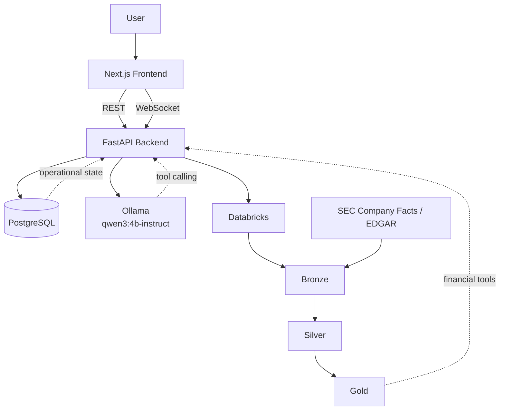
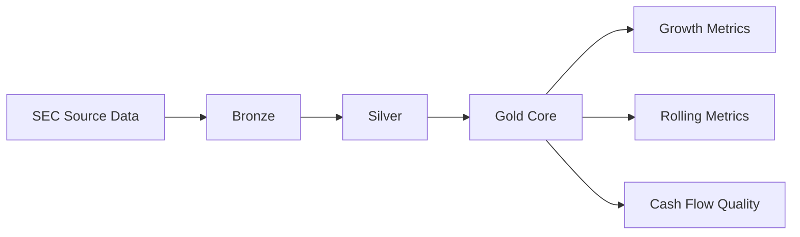
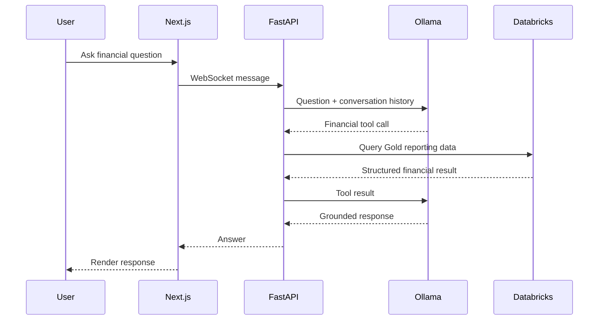
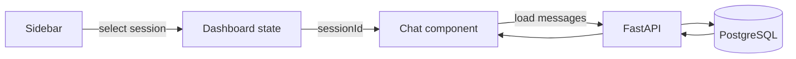

<div align="center">

# AlphaLake

### AI-assisted financial research built on a real data platform

**SEC data → Databricks lakehouse → FastAPI → PostgreSQL → Ollama → Next.js**

[](https://www.python.org/)
[](https://fastapi.tiangolo.com/)
[](https://www.databricks.com/)
[](https://www.postgresql.org/)
[](https://nextjs.org/)
[](https://www.docker.com/)
[](https://www.terraform.io/)

AlphaLake is a hands-on financial research platform that connects **data engineering, backend engineering, cloud infrastructure, AI, and product development** in one system.

Instead of asking an LLM to guess financial facts, AlphaLake gives the model tools backed by structured SEC-derived data and a Databricks analytical layer.

</div>

---

<!--
Add a project banner here when ready:

<p align="center">
  
</p>
-->

## Why AlphaLake?

A financial assistant is only useful when its answers are grounded in reliable data.

AlphaLake explores a simple idea:

> **What if an AI financial assistant sat on top of a proper data platform instead of relying on model memory?**

The project therefore separates responsibilities clearly:

- **SEC** provides the source financial data.
- **Databricks** processes and serves analytical financial metrics.
- **PostgreSQL** stores operational product state such as conversations and messages.
- **FastAPI** connects the product, AI, and data layers.
- **Ollama** provides local LLM inference and tool calling.
- **Next.js** provides the interactive research experience.

The result is not just a chatbot and not just a data pipeline. It is an evolving **full-stack financial research system**.

---

## Demo

<!--
Recommended asset:
docs/assets/alphalake-demo.gif

Record a 15–25 second GIF showing:
1. Open AlphaLake.
2. Ask: "What was Apple's revenue in 2024?"
3. Show the grounded answer.
4. Open an older conversation from the sidebar.
5. Rename a conversation.
6. Create a new chat.

Then uncomment:

<p align="center">
  
</p>
-->

**Current end-to-end flow:**

```text
User asks a financial question
        ↓
Next.js chat interface
        ↓
FastAPI WebSocket
        ↓
Local LLM decides whether a tool is required
        ↓
Financial tool queries Databricks Gold data
        ↓
Structured result returns to the LLM
        ↓
Grounded answer is shown to the user
        ↓
Conversation is persisted in PostgreSQL
```

---

## Architecture



### Architectural split

| Layer | Responsibility |
|---|---|
| **Next.js** | Chat UI, conversation sidebar, user interactions |
| **FastAPI** | REST APIs, WebSockets, orchestration, AI/data integration |
| **PostgreSQL** | Conversations, messages, titles, future watchlists/users |
| **Ollama** | Local LLM inference and tool selection |
| **Databricks** | Analytical financial data and derived metrics |
| **SEC** | Source company facts, ticker/CIK reference data |
| **Terraform** | Databricks infrastructure and job configuration |
| **Docker Compose** | Local integration environment |

For a deeper explanation, see [`architecture.md`](architecture.md).

---

## Data Engineering Pipeline

AlphaLake uses a medallion-style architecture:



### Bronze

Raw or minimally processed SEC data is ingested and preserved for downstream processing.

### Silver

Financial facts are normalized, schema-controlled, validated, and transformed into analysis-ready structures.

### Gold

Gold contains company-level financial outputs and derived analytical metrics.

Current Gold datasets include:

```text
alphalake.gold.company_financials
alphalake.gold.growth_metrics
alphalake.gold.rolling_metrics
alphalake.gold.cash_flow_quality
```

The AI layer queries the reporting view:

```text
alphalake.gold.v_company_financials_report
```

The core Gold financial table uses change-aware merge logic in Databricks, while current derived datasets are rebuilt from the relevant Silver input.

---

## AI Tool Calling

The LLM is not treated as the financial database.

When a question requires structured financial information, the model can call an AlphaLake financial tool.



Current local model:

```text
qwen3:4b-instruct
```

A core design goal is to keep financial answers tied to tool-returned data and minimize unsupported model speculation.

---

## Conversation System

AlphaLake now has persistent conversation history rather than an in-memory-only chat session.

### Implemented

- Create a new chat with a new UUID session ID
- Persist user and assistant messages in PostgreSQL
- Load previous messages when a conversation is selected
- List conversations in the sidebar
- Generate/store conversation titles
- Rename conversations
- Delete conversations
- Show a three-dot action menu on hover
- Close the action menu when clicking outside
- Keep frontend state synchronized with conversation actions



<!--
Recommended screenshot:
docs/assets/conversation-sidebar.png

<p align="center">
  
</p>
-->

---

## Operational Data vs Analytical Data

One of the important architectural decisions in AlphaLake is **not** to use one database for everything.

### PostgreSQL — operational state

PostgreSQL answers questions such as:

- Which conversations exist?
- What messages belong to a conversation?
- What is the current conversation title?
- Which companies will a user eventually watch?

### Databricks — analytical state

Databricks answers questions such as:

- What was a company's annual revenue?
- How did net income change across years?
- What are the derived growth metrics?
- What is the historical cash-flow quality?

```text
PostgreSQL = product/application memory
Databricks = financial analytical memory
```

---

## SEC Company Reference

AlphaLake already uses the SEC ticker dataset:

```text
https://www.sec.gov/files/company_tickers.json
```

The current helper supports:

```text
ticker → CIK
```

This becomes the foundation for a searchable company universe and the upcoming Watchlist feature.

Instead of hardcoding companies in the frontend, the intended flow is:

```text
SEC ticker reference
       ↓
backend/data layer
       ↓
company search
       ↓
user selects ticker
       ↓
watchlist
```

---

## Tech Stack

### Data Engineering

- Python
- PySpark
- Delta Lake
- Databricks
- SEC Company Facts / EDGAR data
- Data-quality validation

### Backend

- FastAPI
- Pydantic
- SQLAlchemy
- REST APIs
- WebSockets

### AI

- Ollama
- `qwen3:4b-instruct`
- OpenAI-compatible Python client
- Tool calling

### Frontend

- Next.js
- React
- TypeScript
- Material UI
- Tailwind CSS
- React Markdown

### Storage

- PostgreSQL — operational state
- Databricks / Delta Lake — analytical data

### Infrastructure

- Docker
- Docker Compose
- Terraform
- GitHub Actions

---

## Dockerized Local Stack

The current local integration environment includes:

```text
Docker Compose
├── frontend
├── backend
├── ollama
└── ollama-pull
```

Databricks remains an external analytical platform.

Typical development ports:

| Service | Port |
|---|---:|
| Next.js | `3000` |
| FastAPI | `8000` |
| PostgreSQL | `5432` |
| Ollama | `11434` |

Inside Compose, the backend communicates with Ollama through the Docker service name rather than `localhost`.

---

## Project Structure

```text
.
├── src/
│   ├── ai/
│   ├── api/
│   ├── db/
│   ├── ingestion/
│   ├── pipelines/
│   ├── quality/
│   ├── runtime/
│   ├── storage/
│   └── transformations/
│
├── frontend/
│   └── alphalake/
│
├── infrastructure/
│   └── terraform/
│
└── architecture.md
```

The exact file structure evolves with the project, but the main separation of responsibilities is intentional.

---

## What I Am Building Next

### Watchlist

The next product feature is a personalized company watchlist.

Planned first version:

```text
User opens Watchlist
        ↓
searches SEC-backed company reference
        ↓
selects a company
        ↓
FastAPI stores watchlist state in PostgreSQL
        ↓
AlphaLake can use Databricks data for that company
```

### Planned roadmap

- [x] SEC financial ingestion
- [x] Bronze / Silver / Gold pipeline
- [x] Databricks analytical layer
- [x] Terraform-managed Databricks jobs
- [x] FastAPI backend
- [x] AI financial tool calling
- [x] WebSocket chat
- [x] Next.js chat UI
- [x] Docker Compose integration
- [x] PostgreSQL conversation persistence
- [x] Conversation history sidebar
- [x] Conversation rename/delete
- [x] SEC ticker → CIK lookup
- [ ] Searchable company reference
- [ ] Watchlist
- [ ] Company detail page
- [ ] Authentication and users
- [ ] SEC filing ingestion
- [ ] RAG over 10-K / 10-Q filings
- [ ] Source citations in AI answers
- [ ] Background jobs / alerts

### Technologies intentionally deferred

Some technologies are deliberately **not** being added until the architecture needs them:

- Redis
- Kafka
- Kubernetes
- additional analytical warehouses such as Snowflake

The goal is to solve real engineering problems, not collect infrastructure keywords.

---

## Engineering Principles

AlphaLake is being developed around a few principles:

1. **Build vertical slices.** A feature should connect frontend, backend, persistence, and data when appropriate.
2. **Separate OLTP and OLAP concerns.** Product state and analytical data have different workloads.
3. **Ground AI in tools.** Financial facts should come from structured data, not model memory.
4. **Keep transformations reusable.** DataFrame transformations should remain separate from orchestration and storage.
5. **Add complexity only when justified.** New infrastructure must solve a real problem.
6. **Learn through implementation.** The project is intentionally built through design, coding, debugging, refactoring, and iteration.

---

## Visual Assets Recommended for This README

For the strongest GitHub presentation, add these files under `docs/assets/`:

```text
docs/assets/
├── alphalake-banner.png
├── alphalake-demo.gif
├── conversation-sidebar.png
├── financial-answer.png
└── databricks-pipeline.png
```

### Best GIF to record

A single 15–25 second GIF can communicate most of the project:

```text
1. Open AlphaLake
2. Ask "What was Apple's revenue in 2024?"
3. Show the answer
4. Switch to an existing conversation
5. Rename it
6. Create a new chat
```

Keep the GIF narrow enough to read comfortably on GitHub and avoid recording your whole desktop.

---

## Project Direction

AlphaLake is evolving toward a small but realistic financial research product where:

```text
Data Engineering
      +
Backend Engineering
      +
Cloud / Infrastructure
      +
AI Tooling
      +
Frontend Product Development
      =
AlphaLake
```

The long-term direction is to make financial research more interactive while keeping the underlying data flow explicit, testable, and grounded.

---

<div align="center">

**Built as an engineering project to understand how modern data platforms, backend systems, and AI applications fit together.**

</div>
