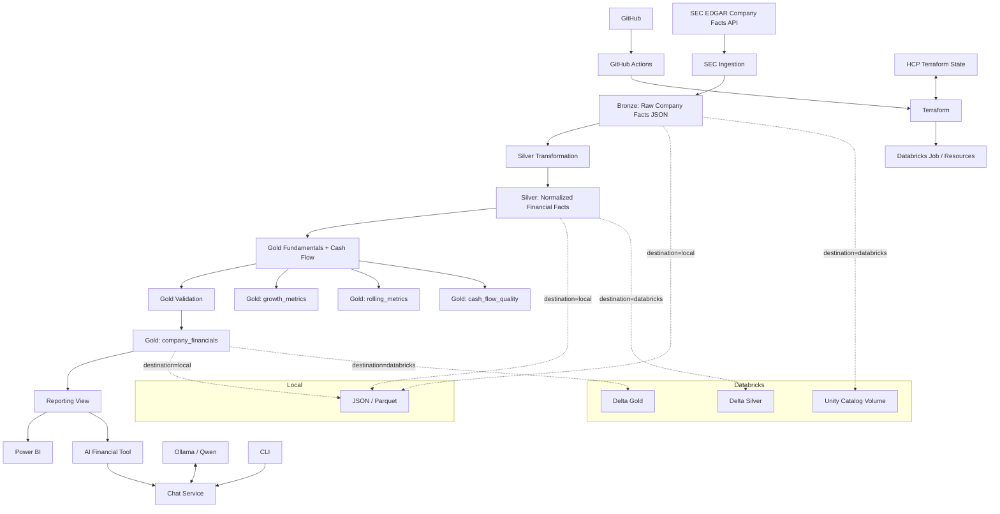

# AlphaLake — Financial Data Lakehouse Platform

AlphaLake is an end-to-end financial data engineering and AI-assisted research project. It ingests public-company financial data from the SEC, processes it through a Bronze/Silver/Gold architecture with PySpark, supports both local and Databricks storage backends, validates analytical data, exposes curated data to reporting, and includes a grounded local AI assistant that retrieves financial data before answering company-financial questions.

The current architecture is intentionally split by responsibility:

```text
ingestion/        → external data acquisition
transformations/  → DataFrame-in / DataFrame-out business logic
storage/          → local and Databricks persistence
pipelines/        → orchestration between stages
runtime/          → Spark runtime creation/configuration
quality/          → validation
ai/               → LLM client, tool calling, and chat service
infrastructure/   → Terraform for Databricks resources
```

The same Bronze, Silver, and Gold pipeline functions are reused for local and Databricks execution. Storage-specific behavior is isolated in `src/storage`.

---

## High-Level Architecture



Core data flow:

```text
SEC
↓
Bronze JSON
↓
Silver financial facts
↓
Gold company_financials
├── growth_metrics
├── rolling_metrics
└── cash_flow_quality
```

AI flow:

```text
User
↓
CLI
↓
chat_service.py
↓
Qwen tool decision
↓
get_financial_report
↓
Databricks SQL
↓
tool result
↓
grounded answer
```

---

# Project Goals

AlphaLake separates source fidelity from analytical interpretation.

### Silver

> How did the SEC report the financial information?

Silver preserves normalized SEC concepts, units, periods, filing metadata, and filing history.

### Gold

> What does the financial information mean analytically?

Gold converts SEC facts into company-level financial metrics and then derives additional analytical datasets.

---

# Technology Stack

## Data Engineering

- Python
- PySpark
- SEC EDGAR Company Facts API
- JSON
- Parquet
- Delta Lake
- Databricks
- Unity Catalog
- Apache Iceberg for local experimentation/synchronization

## Infrastructure / DevOps

- Terraform
- HCP Terraform remote state
- Databricks Terraform Provider
- GitHub
- GitHub Actions

## Analytics

- Databricks SQL
- Power BI

## AI

- Ollama
- Qwen
- OpenAI-compatible Python client
- LLM function/tool calling
- Pandas
- Databricks SQL Connector

---

# Repository Structure

```text
alpha-lake/
│
├── data/
│   ├── bronze/
│   ├── silver/
│   └── gold/
│
├── docs/
│   ├── architecture.md
│   ├── project_scope.md
│   └── images/
│
├── infrastructure/
│   └── terraform/
│       ├── providers.tf
│       ├── variables.tf
│       ├── databricks_job.tf
│       ├── output.tf
│       └── versions.tf
│
├── src/
│   ├── ai/
│   │   ├── client.py
│   │   ├── prompts.py
│   │   ├── chat_service.py
│   │   ├── cli.py
│   │   └── tools/
│   │       ├── financials.py
│   │       ├── registry.py
│   │       └── executor.py
│   │
│   ├── ingestion/
│   │   └── sec/
│   │       ├── client.py
│   │       └── ticker.py
│   │
│   ├── pipelines/
│   │   ├── bronze.py
│   │   ├── silver.py
│   │   ├── gold.py
│   │   └── local.py
│   │
│   ├── quality/
│   │   ├── gold.py
│   │   └── quality.py
│   │
│   ├── runtime/
│   │   └── session.py
│   │
│   ├── storage/
│   │   ├── path.py
│   │   ├── bronze.py
│   │   ├── silver.py
│   │   ├── gold.py
│   │   └── iceberg.py
│   │
│   └── transformations/
│       ├── silver/
│       │   └── sec_facts.py
│       └── gold/
│           ├── fundamentals.py
│           ├── cash_flow.py
│           ├── growth.py
│           ├── rolling.py
│           └── cash_flow_quality.py
│
├── tests/
├── .github/workflows/
├── .gitignore
├── pyproject.toml
└── README.md
```

---

# Layer Responsibilities

## `ingestion/`

Responsible only for retrieving external source data.

Current SEC flow:

```text
ticker
↓
Ticker → CIK mapping
↓
SEC Company Facts API
↓
Python dictionary
```

The ingestion layer does not decide how data is stored.

## `transformations/`

Contains pure analytical transformations as much as possible.

```text
DataFrame
↓
transformation
↓
DataFrame
```

Transformation modules do not decide whether the result is written to local Parquet or Databricks Delta.

## `storage/`

Owns persistence details.

```text
storage/bronze.py
→ Bronze JSON read/write

storage/silver.py
→ Silver Parquet / Delta read/write

storage/gold.py
→ Gold Parquet / Delta write behavior

storage/path.py
→ environment-specific paths and table names
```

Current storage mapping:

```python
STORAGE_PATH = {
    "local": {
        "bronze": "data/bronze/sec",
        "silver": "data/silver/sec",
        "gold": "data/gold/sec",
    },
    "databricks": {
        "bronze": "/Volumes/alphalake/raw/data/bronze/sec",
        "silver": "alphalake.silver.financial_facts",
        "gold": "alphalake.gold",
    },
}
```

## `pipelines/`

Coordinates the layers.

```text
read
↓
transform
↓
validate
↓
write
```

The pipeline contains orchestration, not backend-specific storage implementation.

---

# 1. SEC Data Ingestion

AlphaLake retrieves public-company financial facts from the SEC EDGAR Company Facts API.

Example endpoint:

```text
https://data.sec.gov/api/xbrl/companyfacts/CIKXXXXXXXXXX.json
```

Ticker symbols are mapped to CIK identifiers before fetching company facts.

The SEC requires a descriptive `User-Agent`. AlphaLake passes a name and email into the ingestion functions.

### Local configuration

Local execution reads:

```text
SEC_NAME
SEC_EMAIL
```

from the environment, typically through a local `.env` file that is not committed to Git.

Example:

```env
SEC_NAME=Your Name
SEC_EMAIL=your-email@example.com
```

### Databricks configuration

Do not hardcode the SEC identity inside notebooks.

Use Databricks Job parameters (or a Databricks secret if preferred) and pass the values into `run_bronze()`.

A thin Bronze notebook can look like:

```python
dbutils.widgets.text("sec_name", "")
dbutils.widgets.text("sec_email", "")

name = dbutils.widgets.get("sec_name")
email = dbutils.widgets.get("sec_email")

from src.pipelines.bronze import run_bronze

run_bronze(
    tickers=["AAPL", "MSFT"],
    name=name,
    email=email,
    destination="databricks",
)
```

The notebook only provides runtime parameters and calls the shared Python pipeline. It should not duplicate ingestion or transformation logic.

---

# 2. Bronze Layer

Bronze preserves the original SEC Company Facts response.

Local example:

```text
data/bronze/sec/AAPL/companyfacts.json
```

Databricks example:

```text
/Volumes/alphalake/raw/data/bronze/sec/AAPL/companyfacts.json
```

The same `save_company_facts()` interface is used for both destinations because both are file-based JSON storage.

Silver reads the full JSON document as text (`wholetext=True`) so it can be parsed consistently by the Silver transformation.

---

# 3. Silver Layer

Silver normalizes the nested SEC Company Facts JSON into filing-level financial facts.

Typical fields include:

```text
ticker
concept
unit
accession_number
period_start_date
period_end_date
filing_date
filing_form
fiscal_period
reporting_frame
fiscal_year
value
```

Databricks table:

```text
alphalake.silver.financial_facts
```

Local dataset:

```text
data/silver/sec/financial_facts/
```

Silver is partitioned by `ticker`.

### Write behavior

Local:

```text
Parquet
+ dynamic partition overwrite
```

Databricks:

```text
Delta
+ replaceWhere ticker = <ticker>
```

`read_silver()` can return:

- all Silver data, or
- only one ticker when `ticker=` is supplied.

This allows Gold to read the full Silver dataset without duplicating local/Databricks read logic.

---

# 4. Gold Layer

Gold has a core dataset plus derived analytical datasets.

## Core Gold table

```text
company_financials
```

Produced from:

```text
Silver
├── annual_derived_metrics()
└── annual_cash_flow_metrics()
       ↓
join on ticker + period_date
       ↓
company_financials
```

Typical fields include:

```text
ticker
period_date
revenue
net_income
operating_income
assets
equity
operating_margin
net_profit_margin
return_on_assets
return_on_equity
operating_cash_flow
operating_cash_flow_source
capex
capex_source
free_cash_flow
```

The business key is:

```text
ticker + period_date
```

## Derived Gold datasets

The core Gold DataFrame is then used to create:

```text
growth_metrics
rolling_metrics
cash_flow_quality
```

Conceptually:

```text
Silver financial_facts
        ↓
fundamentals + cash flow
        ↓
company_financials
        ├── annual_growth_metrics()
        │       ↓
        │   growth_metrics
        │
        ├── rolling_metrics()
        │       ↓
        │   rolling_metrics
        │
        └── cash_flow_quality()
                ↓
            cash_flow_quality
```

Databricks tables:

```text
alphalake.gold.company_financials
alphalake.gold.growth_metrics
alphalake.gold.rolling_metrics
alphalake.gold.cash_flow_quality
```

Local datasets:

```text
data/gold/sec/company_financials/
data/gold/sec/growth_metrics/
data/gold/sec/rolling_metrics/
data/gold/sec/cash_flow_quality/
```

---

# 5. Gold Write Strategy

The core and derived Gold datasets intentionally use different update strategies.

## `company_financials`

Databricks compares incoming rows with the existing table using:

```text
ticker + period_date
```

Only new or changed records are passed into a Delta `MERGE`.

```text
incoming row
   ↓
new?       → MERGE
changed?   → MERGE
identical? → skip
```

This avoids unnecessary updates to the main historical Gold table.

## Derived Gold tables

`growth_metrics`, `rolling_metrics`, and `cash_flow_quality` are deterministic outputs recalculated from the complete core Gold dataset.

Current Databricks behavior is therefore:

```text
recompute complete derived dataset
↓
overwrite complete derived table
```

This is intentionally simpler than maintaining independent incremental logic for each derived dataset.

Because of this design, the Gold pipeline should receive the complete Silver dataset when running a full Gold refresh.

---

# 6. Data Quality

Core Gold data is validated before it is written.

Current checks include:

```text
dataset is not empty
ticker is not null
period_date is not null
ticker + period_date is unique
```

Pipeline order:

```text
Gold transformation
↓
validate_gold()
↓
write company_financials
↓
write derived Gold datasets
```

A failed validation raises an exception and prevents invalid core Gold data from being published.

---

# 7. Local Pipeline

The local entrypoint is:

```text
src/pipelines/local.py
```

It creates the Spark runtime, reads the SEC identity from environment variables, and calls the same shared pipeline functions used by the Databricks path.

Conceptually:

```python
spark = get_spark_session()

run_bronze(
    tickers,
    name,
    email,
    destination="local",
)

run_silver(
    spark,
    tickers,
    destination="local",
)

silver_df = read_silver(
    spark=spark,
    destination="local",
)

run_gold(
    silver_df,
    destination="local",
)
```

The refactored local Bronze → Silver → Gold path has been executed successfully.

---

# 8. Databricks Pipeline

AlphaLake does not maintain a second copy of the pipeline logic for Databricks.

Instead:

```text
Databricks notebook / Job task
↓
shared src/pipelines/* function
↓
shared transformations
↓
storage backend selected by destination="databricks"
```

Recommended Databricks task entrypoints are thin notebooks, for example:

```text
notebooks/
├── bronze.py
├── silver.py
└── gold.py
```

### Bronze notebook

```python
from src.pipelines.bronze import run_bronze

run_bronze(
    tickers=tickers,
    name=sec_name,
    email=sec_email,
    destination="databricks",
)
```

### Silver notebook

```python
from src.pipelines.silver import run_silver

run_silver(
    spark=spark,
    tickers=tickers,
    destination="databricks",
)
```

### Gold notebook

```python
from src.storage.silver import read_silver
from src.pipelines.gold import run_gold

silver_df = read_silver(
    spark=spark,
    destination="databricks",
)

run_gold(
    silver_df,
    destination="databricks",
)
```

The notebooks should contain runtime wiring only. Business logic stays in the Python package.

---

# 9. Databricks Lakehouse

Unity Catalog layout:

```text
alphalake
├── raw
│   └── Volume: data
│       └── bronze/sec/<TICKER>/companyfacts.json
│
├── silver
│   └── financial_facts
│
└── gold
    ├── company_financials
    ├── growth_metrics
    ├── rolling_metrics
    └── cash_flow_quality
```

Production storage flow:

```text
SEC
↓
Unity Catalog Volume (Bronze JSON)
↓
Delta Silver table
↓
Delta Gold tables
```

---

# 10. Reporting

Power BI consumes a stable Gold reporting view rather than coupling directly to internal transformation code.

Current reporting view:

```text
alphalake.gold.v_company_financials_report
```

Flow:

```text
company_financials
↓
v_company_financials_report
↓
Power BI
```

---

# 11. AI Assistant

AlphaLake includes a local AI assistant based on Ollama and Qwen.

Package:

```text
src/ai/
├── client.py
├── prompts.py
├── chat_service.py
├── cli.py
└── tools/
    ├── financials.py
    ├── registry.py
    └── executor.py
```

Responsibilities:

```text
client.py
→ creates the OpenAI-compatible Ollama client

prompts.py
→ contains grounding instructions

chat_service.py
→ decides whether a tool is needed, executes requested tools, and produces the final answer

cli.py
→ terminal input/output

tools/registry.py
→ exposes tool schemas to the LLM

tools/executor.py
→ dispatches tool calls

tools/financials.py
→ queries Databricks financial data
```

`tool_choice="auto"` allows normal conversational questions to be answered without forcing a database tool call, while financial-number questions are grounded through the registered tool.

The current service supports multiple tool calls returned in one LLM turn before producing the final answer.

---

# 12. Infrastructure and CI/CD

Terraform lives at:

```text
infrastructure/terraform/
```

It remains separate from Python runtime infrastructure.

Terraform manages Databricks resources such as:

```text
Jobs
Task dependencies
Git configuration
Serverless environment
Job parameters
Schedule
```

Deployment flow:

```text
GitHub
↓
GitHub Actions
↓
terraform fmt
terraform init
terraform validate
terraform plan
↓
terraform apply
↓
Databricks
```

Terraform state is stored remotely in HCP Terraform.

---

# 13. Scheduling

The Databricks workflow is scheduled through Terraform.

Example:

```hcl
schedule {
  quartz_cron_expression = "0 0 7 * * ?"
  timezone_id            = "Europe/Berlin"
  pause_status           = "UNPAUSED"
}
```

Typical job flow:

```text
Bronze
↓
Silver
↓
Gold
```

Gold performs its core quality validation before publishing the Gold outputs.

---

# 14. Local Iceberg Experimentation

Apache Iceberg remains available as an optional local synchronization/experimentation path.

It is not part of the primary storage abstraction used by the current Bronze/Silver/Gold pipeline.

Its purpose is to explore:

```text
MERGE behavior
snapshot history
table-format semantics
```

The primary current local pipeline uses JSON + Parquet; the primary Databricks implementation uses Delta Lake.

---

# 15. Current and Planned Application Architecture

Implemented:

```text
SEC ingestion
Bronze / Silver / Gold
shared local + Databricks pipeline logic
data quality
Delta / Unity Catalog
Terraform + HCP state
GitHub Actions
Power BI reporting
CLI-based grounded AI assistant
Databricks-backed financial tool calling
```

Next application milestone:

```text
FastAPI
├── POST /chat
├── GET /companies/{ticker}
└── GET /health
```

The API should reuse `chat_service.py` rather than duplicate AI logic.

Later extensions may include:

```text
automatic company onboarding from SEC
additional deterministic financial tools
SEC filing text ingestion
RAG over annual reports / filings
company comparison workflows
research-oriented AI features
```

AlphaLake is intended to support evidence-based financial research, not to provide buy/sell recommendations.
