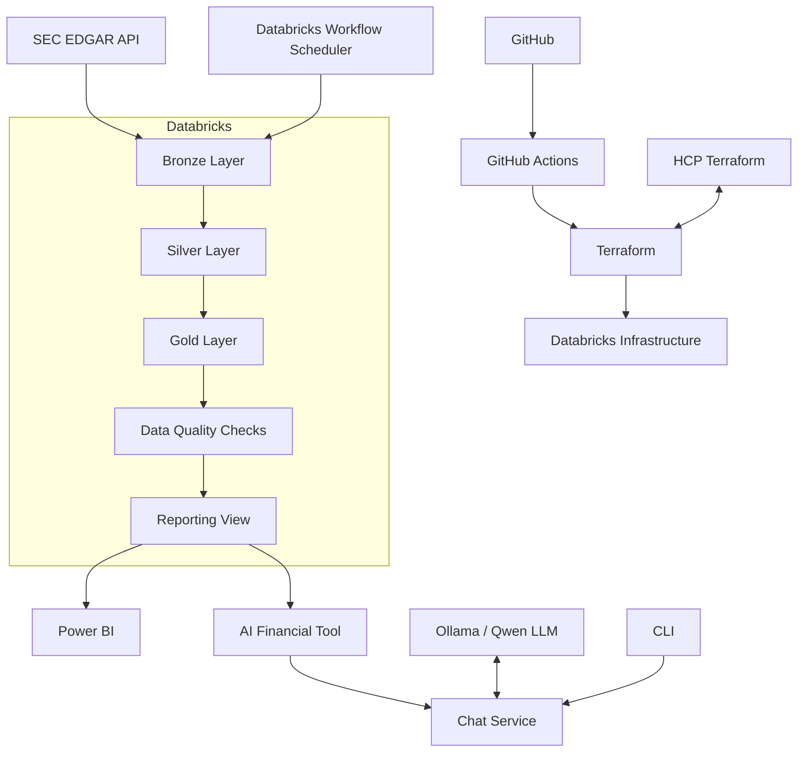
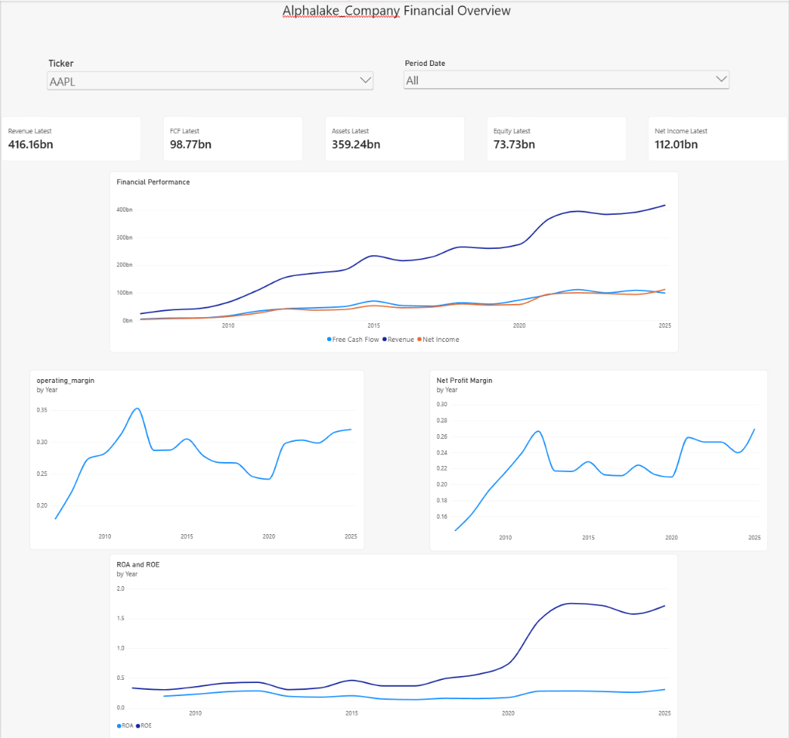

# AlphaLake — Financial Data Lakehouse Platform

AlphaLake is an end-to-end financial data lakehouse and AI-assisted research platform. It ingests public-company financial data from the SEC, transforms it through a Bronze/Silver/Gold architecture, validates the analytical dataset, exposes it to Power BI, and now includes a grounded AI assistant that retrieves financial data from Databricks before answering company-financial questions.

The project was built as a practical Data Engineering project and is now being extended toward an AI-assisted fundamental research application. It covers:

- Data ingestion
- PySpark transformations
- Medallion architecture
- Delta Lake / Unity Catalog
- Databricks Workflows
- Data quality
- Infrastructure as Code
- Remote Terraform state
- CI/CD with GitHub Actions
- Automated scheduling
- Power BI reporting
- Local LLM integration with Ollama / Qwen
- LLM function calling with Databricks-backed financial tools
- Modular AI service architecture

---

## Architecture



Main data flow:

```text
SEC EDGAR → Bronze → Silver → Gold → Data Quality → Reporting View
```

Consumer paths:

```text
Reporting View → Power BI
Reporting View → AI financial tool → LLM → grounded answer
```

Infrastructure deployment:

```text
GitHub → GitHub Actions → Terraform → Databricks
```

Terraform state is stored remotely in HCP Terraform. See [`docs/architecture.md`](docs/architecture.md) for the detailed architecture.

---

# Project Goals

AlphaLake was designed to answer two different questions at different layers.

### Silver

> How did the SEC report the financial information?

The Silver layer preserves normalized SEC filing facts and filing history.

### Gold

> What does the financial information mean analytically?

The Gold layer converts raw accounting facts into company-level financial metrics suitable for analytics and reporting.

---

# Technology Stack

## Data Engineering

- Python
- PySpark
- SEC EDGAR Company Facts API
- JSON
- Parquet
- Delta Lake
- Apache Iceberg for local experimentation
- Databricks
- Unity Catalog

## Infrastructure

- Terraform
- HCP Terraform
- Databricks Terraform Provider

## CI/CD

- GitHub
- GitHub Actions

## Analytics

- Databricks SQL
- Power BI
- Local LLM integration
- LLM tool/function calling
- Grounded financial question answering
- Separation of CLI, chat service, tool registry, executor, and data tool
- DAX

## AI / Application

- Ollama
- Qwen
- OpenAI-compatible Python client
- LLM function/tool calling
- Pandas
- Databricks SQL Connector

---

# Repository Structure

```text
alpha-lake/
│
├── data/
│   ├── bronze/
│   ├── silver/
│   └── gold/
│
├── docs/
│   ├── architecture.md
│   ├── project_scope.md
│   └── images/
│
├── terraform/
│   ├── providers.tf
│   ├── variables.tf
│   ├── databricks_job.tf
│   ├── outputs.tf
│   └── versions.tf
│
├── src/
│   ├── ai/
│   │   ├── client.py
│   │   ├── prompts.py
│   │   ├── chat_service.py
│   │   ├── cli.py
│   │   └── tools/
│   │       ├── financials.py
│   │       ├── registry.py
│   │       └── executor.py
│   │
│   ├── bronze/
│   ├── ingestion/sec/
│   ├── silver/
│   ├── gold/
│   ├── quality/
│   ├── infrastructure/
│   └── pipeline.py
│
├── tests/
├── .github/workflows/
├── .gitignore
├── pyproject.toml
└── README.md
```

The AI package is separated by responsibility: the CLI handles terminal I/O, the chat service orchestrates the conversation, the registry describes tools to the LLM, the executor dispatches tool calls, and the financial tool performs Databricks-backed retrieval.

---

# 1. SEC Data Ingestion

Financial data is retrieved from the official SEC EDGAR Company Facts API.

Example endpoint:

```text
https://data.sec.gov/api/xbrl/companyfacts/CIKXXXXXXXXXX.json
```

Ticker symbols are mapped to SEC CIK identifiers before retrieving company facts.

The ingestion layer supports multiple companies and stores the original SEC response in the Bronze layer.

Example:

```text
Ticker
  ↓
Ticker → CIK mapping
  ↓
SEC Company Facts API
  ↓
Raw JSON
```

---

# 2. Bronze Layer

The Bronze layer preserves the original SEC Company Facts JSON.

In Databricks, Bronze files are stored inside a Unity Catalog Volume:

```text
/Volumes/alphalake/raw/data/bronze/sec/<TICKER>/companyfacts.json
```

Example:

```text
/Volumes/alphalake/raw/data/bronze/sec/AAPL/companyfacts.json
```

The Bronze layer intentionally performs minimal transformation.

Its purpose is to preserve the source data for reproducibility and reprocessing.

---

# 3. Silver Layer

The SEC Company Facts JSON contains deeply nested financial facts.

PySpark is used to flatten and normalize these structures into a structured dataset.

The Silver schema contains fields such as:

```text
ticker
concept
unit
accession_number
period_start_date
period_end_date
filing_date
filing_form
fiscal_period
reporting_frame
fiscal_year
value
```

The production Silver table is:

```text
alphalake.silver.financial_facts
```

The Silver layer preserves filing history instead of immediately reducing the data to one value per company and year.

---

# 4. Gold Layer

The Gold layer converts SEC accounting concepts into analytical financial metrics.

The primary table is:

```text
alphalake.gold.company_financials
```

The table contains company-level annual financial metrics including:

```text
ticker
period_date

revenue
net_income
operating_income

assets
equity

operating_margin
net_profit_margin

return_on_assets
return_on_equity

operating_cash_flow
capex
free_cash_flow
```

---

## Financial Metric Logic

Several SEC concepts may represent the same financial meaning.

AlphaLake therefore implements preferred and fallback accounting concepts when building analytical metrics.

Examples include:

```text
Revenue
Operating Cash Flow
Capital Expenditure
```

The Gold layer also tracks source provenance for selected financial metrics.

For example:

```text
operating_cash_flow_source
capex_source
```

---

# 5. Incremental Gold Updates

The business key of the Gold dataset is:

```text
ticker + period_date
```

Before updating the Gold table, AlphaLake compares incoming rows with existing rows.

Only changed or new rows are merged.

Conceptually:

```text
New Gold Dataset
        ↓
Compare against existing Gold
        ↓
New row? ───────────────→ MERGE
Changed row? ───────────→ MERGE
Identical row? ─────────→ Skip
```

This avoids unnecessary table rewrites and unnecessary Delta/Iceberg versions.

---

# 6. Local Development

The project was initially developed locally using PySpark.

Local storage was used for development and experimentation with:

- Parquet
- Apache Iceberg
- Spark SQL
- MERGE operations
- Snapshot history

Apache Iceberg was used locally to understand table formats, snapshot lineage, and change-aware MERGE behavior.

The production Databricks implementation uses Delta Lake and Unity Catalog.

This keeps transformation logic independent from the underlying storage implementation.

```text
Transformation Logic
       ↓
Storage Adapter
   ↙         ↘
Local       Databricks
```

---

# 7. Databricks Lakehouse

The production environment uses Databricks Free Edition with serverless compute.

Unity Catalog structure:

```text
Catalog
└── alphalake
    │
    ├── raw
    │   └── Volume: data
    │
    ├── silver
    │   └── financial_facts
    │
    └── gold
        └── company_financials
```

The full production flow is therefore:

```text
SEC
 ↓
Unity Catalog Volume
 ↓
Silver Delta Table
 ↓
Gold Delta Table
```

---

# 8. Databricks Workflow

The pipeline is implemented as a multi-task Databricks Job.

```text
01_bronze_ingestion
        ↓
02_silver_transform
        ↓
03_gold_transform
        ↓
04_gold_quality
```

Each task has a single responsibility.

### Task 1 — Bronze

Retrieves SEC financial information and stores the raw JSON.

### Task 2 — Silver

Transforms the SEC JSON into normalized financial facts.

### Task 3 — Gold

Builds company-level analytical financial metrics.

### Task 4 — Data Quality

Validates the final Gold dataset.

---

# 9. Data Quality

AlphaLake includes a dedicated Gold-layer quality module:

```text
src/quality/gold_quality.py
```

Current checks include:

### Non-empty dataset

The Gold dataset must contain records.

### Non-null business keys

The following fields cannot be null:

```text
ticker
period_date
```

### Unique business key

The combination:

```text
ticker + period_date
```

must be unique.

If any validation fails, an exception is raised and the Databricks workflow fails.

```text
Gold
 ↓
Quality Check
 ↓
Valid ─────→ Pipeline succeeds
Invalid ───→ Pipeline fails
```

This prevents silent publication of invalid analytical data.

---

# 10. Automated Scheduling

The Databricks workflow is scheduled through Terraform.

Example:

```hcl
schedule {
  quartz_cron_expression = "0 0 7 * * ?"
  timezone_id            = "Europe/Berlin"
  pause_status           = "UNPAUSED"
}
```

The pipeline therefore runs automatically and refreshes financial data without manual intervention.

---

# 11. Infrastructure as Code

Databricks infrastructure is managed using Terraform.

Terraform manages resources such as:

```text
Databricks Jobs
Job Tasks
Task Dependencies
Git Configuration
Serverless Environment
Job Parameters
Job Schedule
```

Example deployment flow:

```text
Terraform Configuration
        ↓
Databricks Provider
        ↓
Databricks Job
```

---

# 12. Remote Terraform State

Terraform state is stored remotely using HCP Terraform.

This allows both local development and GitHub Actions to work with the same infrastructure state.

```text
VS Code
       \
        → HCP Terraform State
       /
GitHub Actions
```

This avoids keeping infrastructure state only on a developer machine.

Sensitive Terraform state files are excluded from Git:

```gitignore
*.tfstate
*.tfstate.*
terraform.tfvars
.terraform/
```

---

# 13. GitHub Actions CI/CD

Infrastructure deployment is automated using GitHub Actions.

The CI pipeline performs:

```text
terraform fmt
terraform init
terraform validate
terraform plan
```

For pushes to the `main` branch, Terraform also executes:

```text
terraform apply
```

The deployment flow is:

```text
Git Push
   ↓
GitHub Actions
   ↓
Terraform Init
   ↓
Terraform Validate
   ↓
Terraform Plan
   ↓
Terraform Apply
   ↓
Databricks Updated
```

Pull requests can therefore validate infrastructure changes before deployment while changes merged into `main` can automatically update Databricks.

---

## GitHub Secrets

Sensitive credentials are stored using GitHub Actions Secrets rather than being committed to Git.

Examples:

```text
TF_API_TOKEN
DATABRICKS_TOKEN
SEC_NAME
SEC_EMAIL
```

Non-sensitive configuration can be stored as GitHub repository variables:

```text
DATABRICKS_HOST
ALPHALAKE_ENV
GITHUB_REPO_URL
```

Terraform variables are passed using the standard environment-variable convention:

```text
TF_VAR_<variable_name>
```

---

# 14. Reporting Layer

Power BI is not connected directly to the internal Gold implementation.

A reporting view provides a stable consumer-facing interface:

```sql
CREATE OR REPLACE VIEW alphalake.gold.v_company_financials_report AS
SELECT
    ticker,
    period_date,
    revenue,
    net_income,
    operating_income,
    assets,
    equity,
    operating_margin,
    net_profit_margin,
    return_on_assets,
    return_on_equity,
    operating_cash_flow,
    capex,
    free_cash_flow
FROM alphalake.gold.company_financials;
```

Architecture:

```text
Gold Table
    ↓
Reporting View
    ↓
Power BI
```

This decouples the reporting layer from the internal Gold-table implementation.

---

# 15. Power BI Dashboard

The Power BI dashboard provides an interactive company financial overview.

Users can select:

```text
Ticker
Period Date
```

The dashboard currently includes:

### Latest Financial KPIs

- Revenue
- Net Income
- Free Cash Flow
- Assets
- Equity

The cards use DAX measures that retrieve the latest available reporting period rather than summing historical values.

Example:

```DAX
Revenue Latest =
VAR LatestDate =
    MAX(v_company_financials_report[period_date])
RETURN
    CALCULATE(
        MAX(v_company_financials_report[revenue]),
        v_company_financials_report[period_date] = LatestDate
    )
```

---

## Historical Financial Performance

The dashboard visualizes:

```text
Revenue
Net Income
Free Cash Flow
```

over time.

---

## Profitability Analysis

Additional charts show:

```text
Operating Margin
Net Profit Margin
```

over time.

---

## Return Metrics

AlphaLake also displays:

```text
Return on Assets
Return on Equity
```

over time.

---

# Current Dashboard

The current dashboard contains:

```text
                     AlphaLake Company Financial Overview

          [ Ticker ]                    [ Period Date ]

 Revenue       FCF        Assets        Equity       Net Income


                    Financial Performance
             Revenue / Net Income / Free Cash Flow


        Operating Margin             Net Profit Margin


                         ROA / ROE
```

The dashboard allows users to interactively analyze the financial history of individual companies.

---

# 16. AlphaLake AI Assistant

AlphaLake now includes a working local AI assistant for structured financial questions. The assistant uses a local Qwen model through Ollama's OpenAI-compatible endpoint.

For company financial questions, the system prompt requires the model to retrieve AlphaLake data through an available financial tool instead of answering from pretrained knowledge.

Current request flow:

```text
User question
    ↓
CLI
    ↓
Chat Service
    ↓
Ollama / Qwen
    ↓
Tool request
    ↓
Tool Registry + Executor
    ↓
get_financial_report()
    ↓
Databricks SQL reporting view
    ↓
DataFrame → JSON
    ↓
LLM
    ↓
Grounded answer
```

Current AI structure:

```text
src/ai/
├── client.py          # creates the LLM client
├── prompts.py         # AlphaLake system instructions
├── chat_service.py    # conversation and tool-call orchestration
├── cli.py             # terminal interface
└── tools/
    ├── financials.py  # Databricks-backed financial function
    ├── registry.py    # tool schemas exposed to the LLM
    └── executor.py    # tool-name → Python-function dispatch
```

Example supported question:

```text
Compare Apple's net profit margin in 2020, 2022, and 2025.
```

The exact financial values come from AlphaLake's Databricks reporting layer; the LLM is responsible for explaining and comparing the retrieved results.

This follows a deliberate design rule:

```text
Exact numbers and deterministic calculations → SQL / Python
Explanation and synthesis                 → LLM
```

The next application milestone is to expose the reusable chat service through FastAPI. Planned endpoints are:

```text
POST /chat
GET  /companies/{ticker}
GET  /health
```

FastAPI is not yet part of the implemented architecture.

---

# End-to-End Platform

The completed AlphaLake v1 architecture is:

```text
                        DATA SOURCE

                         SEC EDGAR
                             │
                             ▼
                         BRONZE
                      Raw SEC JSON
                             │
                             ▼
                         SILVER
                Normalized Financial Facts
                             │
                             ▼
                          GOLD
                Analytical Financial Metrics
                             │
                             ▼
                     DATA QUALITY
                             │
                             ▼
                     REPORTING VIEW
                             │
                             ▼
                        POWER BI


                    AI RESEARCH PATH

                REPORTING VIEW
                     │
                     ▼
              Financial Tool
                     │
                     ▼
                 Chat Service
                  ↕       │
            Ollama/Qwen   ▼
                         CLI


                 INFRASTRUCTURE LAYER

GitHub
   │
   ▼
GitHub Actions
   │
   ▼
Terraform ─────────── HCP Terraform State
   │
   ▼
Databricks


                 ORCHESTRATION LAYER

Databricks Workflow
       │
       ├── Bronze
       ├── Silver
       ├── Gold
       └── Quality
       
       ↓

Scheduled execution
```

---

# Key Engineering Concepts Demonstrated

AlphaLake demonstrates practical experience with:

- REST API ingestion
- JSON processing
- PySpark
- Distributed transformations
- Medallion architecture
- Data lakehouse design
- Delta Lake
- Apache Iceberg
- Unity Catalog
- Data modeling
- Financial data normalization
- Incremental processing
- MERGE operations
- Change detection
- Data quality validation
- Databricks Jobs
- Workflow dependencies
- Serverless Databricks
- Infrastructure as Code
- Terraform
- Remote Terraform state
- CI/CD
- GitHub Actions
- Secret management
- Databricks SQL
- DAX
- Power BI

---

# Design Principles

AlphaLake follows several engineering principles.

### Separation of concerns

```text
Ingestion
Transformation
Storage
Quality
Infrastructure
Reporting
```

are implemented as separate responsibilities.

### Storage-independent transformations

Transformation logic does not depend directly on whether the platform runs locally or in Databricks.

### Reproducible infrastructure

Databricks infrastructure is defined as code using Terraform.

### Automated deployment

Infrastructure changes are deployed through GitHub Actions rather than manual configuration.

### Data quality before consumption

Analytical data is validated before being treated as trusted reporting data.

### Stable reporting contract

Power BI consumes a dedicated SQL view instead of depending directly on internal Gold-table implementation details.

### Grounded AI responses

Financial values are retrieved from AlphaLake data through deterministic tools before the LLM explains them. The model is not used as the source of truth for financial figures.

### Interface-independent chat logic

Terminal I/O is isolated in `cli.py`, while reusable conversation and tool-calling logic lives in `chat_service.py`. This prepares the application for a future FastAPI interface without duplicating AI logic.

## Dashboard Preview



---

# Future Improvements

The next planned extensions are:

- FastAPI application layer (`/chat`, `/companies/{ticker}`, `/health`)
- Per-session conversation state for API clients
- Automatic onboarding when a requested company is not yet available in AlphaLake
- Additional deterministic financial tools and company comparisons
- SEC 10-K / 10-Q text ingestion
- Chunking, embeddings, semantic retrieval, and RAG over SEC filings
- Evidence-backed risk and filing analysis
- Additional companies and financial metrics
- Market-price data and valuation metrics
- Monitoring and alerting
- Additional automated tests and quality checks

The long-term direction is an AI-assisted fundamental research platform. AlphaLake should retrieve evidence, calculate reliable metrics, and explain financial information; it is not intended to predict stock prices or make investment decisions for the user.

---

# Project Status

**AlphaLake data platform v1: Complete — AI application layer: In progress**

Current platform capabilities:

```text
SEC ingestion               ✅
Bronze layer                ✅
Silver layer                ✅
Gold layer                  ✅
Incremental processing      ✅
Databricks migration        ✅
Unity Catalog               ✅
Databricks Workflow         ✅
Automated scheduling        ✅
Data quality                ✅
Terraform IaC               ✅
HCP remote state            ✅
GitHub Actions CI/CD        ✅
Reporting SQL view          ✅
Power BI dashboard          ✅
Local Ollama / Qwen client  ✅
Financial tool calling      ✅
Databricks-grounded Q&A     ✅
Modular AI package          ✅
FastAPI application         🚧 Planned next
SEC filing RAG              🚧 Planned later
```

---

# Author

Built as a hands-on Data Engineering, Lakehouse, and AI-assisted financial research project demonstrating ingestion, transformation, deployment, automation, analytics, grounded LLM tool calling, and the evolution of a data platform into an application.