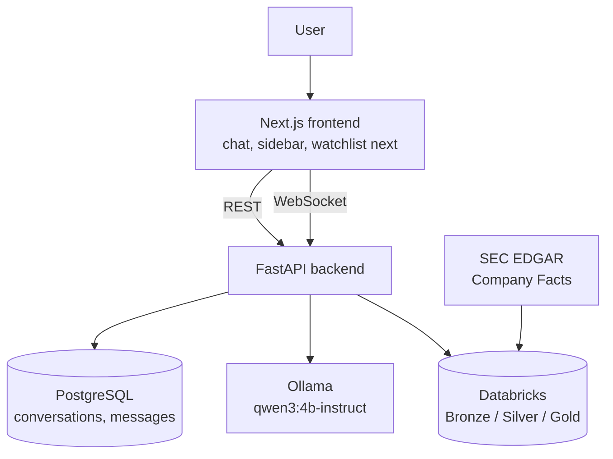

# AlphaLake

**An AI-assisted financial research platform: SEC filings become clean, validated company fundamentals, and a chat assistant answers questions from that data instead of from its memory.**


<!-- TODO: add CI, license and coverage badges once available -->

Next.js chat UI → FastAPI → local LLM (Ollama) with tool calling → Databricks Gold data built from SEC EDGAR.

<!-- TODO: add a 20-30 second GIF of the chat UI answering a question -->
<!--  -->

---

## Why this exists

Public-company financials are free but hard to use. SEC XBRL data is nested, inconsistently tagged across companies, and full of restated and duplicated facts. LLMs, meanwhile, readily invent financial numbers.

AlphaLake tackles both problems:

1. **Clean the data once, properly.** Raw filings are preserved, normalized into filing-level facts, and turned into validated company-level metrics (Bronze / Silver / Gold lakehouse).
2. **Make the AI answer from data.** The assistant calls a financial tool and answers from the returned rows. Tool output is treated as authoritative, and unsupported claims are discouraged.

> AlphaLake supports evidence-based research. It does not give buy/sell recommendations or investment advice.

---

## Features

- **Chat assistant** with live WebSocket streaming and tool calling over financial data
- **Persistent conversations** in PostgreSQL: create, switch, rename, delete
- **Financial metrics:** revenue, net income, margins, ROA, ROE, operating cash flow, capex, free cash flow, growth, rolling metrics, cash-flow quality
- **Lakehouse pipeline** (PySpark) that runs locally or on Databricks with the same code
- **Data validation** before Gold data is published
- **Infrastructure as code:** Terraform-managed Databricks jobs and schedule, GitHub Actions CI
- **Local-first AI:** Ollama with `qwen3:4b-instruct`, no external LLM API needed

<!-- TODO: add a screenshot of the chat UI and a sample Gold table -->

---

## Example

```text
You: How has Apple's free cash flow changed over the last 5 years?

AlphaLake: <!-- TODO: paste a real transcript, including the tool call and the figures returned -->
```

---

## Architecture



**Operational vs analytical data**

| Store | Holds | Answers |
|---|---|---|
| PostgreSQL | conversations, messages, (next) watchlists, (future) users | What does the app or user currently own or remember? |
| Databricks | SEC facts, normalized data, metrics, reporting views | What financial data can AlphaLake analyze? |

**Data layers**

| Layer | Contents | Question it answers |
|---|---|---|
| Bronze | Original SEC Company Facts JSON | What did the SEC return? |
| Silver | Normalized filing-level facts (concept, unit, period, accession number, filing date) | How did the company report it? |
| Gold | `company_financials`, `growth_metrics`, `rolling_metrics`, `cash_flow_quality`, plus reporting view `v_company_financials_report` | What does it mean analytically? |

**Design principle:** transformations are pure DataFrame-in / DataFrame-out functions; storage backends are swapped with `destination="local" | "databricks"`.

```
src/
├── ai/               LLM client, tool calling, chat orchestration
├── api/              FastAPI routes (REST + WebSocket)
├── db/               PostgreSQL access
├── ingestion/        SEC data acquisition
├── transformations/  business logic, no I/O
├── storage/          local and Databricks persistence
├── pipelines/        orchestration
├── quality/          validation
└── runtime/          Spark session setup
frontend/alphalake/   Next.js app
infrastructure/       Terraform (Databricks)
```

Deep dives: [Architecture](docs/architecture.md) · [Project scope](docs/project_scope.md)

---

## Quickstart

**Prerequisites:** Docker and Docker Compose; a Databricks workspace with the Gold tables populated (see [Data pipeline](#data-pipeline)).

```bash
git clone https://github.com/vahidsadat/alpha-lake.git
cd alpha-lake

cp .env.example .env     # TODO: add .env.example and list required variables
# Databricks connection settings go here (host, HTTP path, token)  # TODO: name the exact variables

docker compose up        # starts frontend, backend, ollama, and pulls the model
```

Then open the frontend at `http://localhost:3000` <!-- TODO: verify port -->.

> **Current limitation:** the financial tool queries Databricks SQL, so the full experience needs a Databricks workspace. A local Parquet/DuckDB backend is planned so AlphaLake can run with no cloud account.

<!-- TODO: confirm PostgreSQL is part of docker-compose.yml; if not, add it or document how to start it -->

---

## Data pipeline

Run Bronze → Silver → Gold locally (JSON and Parquet) or on Databricks (Unity Catalog volume and Delta tables).

```bash
uv sync
# TODO: verify the exact command
uv run python -m src.pipelines.local
```

On Databricks the same functions run as thin notebook tasks, scheduled by Terraform.

- Silver: Delta with `replaceWhere` per ticker
- Gold `company_financials`: change-aware Delta `MERGE` on `ticker + period_date`
- Derived Gold tables: fully recomputed and overwritten, so the full Silver dataset must be available when rebuilding

---

## Data quality

Gold data is validated before publishing, and a failed check stops the pipeline.

Current checks: non-empty dataset, non-null `ticker` and `period_date`, unique `ticker + period_date`.

**Planned:** accounting identity checks, outlier detection, restatement handling, and a published accuracy benchmark against a reference dataset.

---

## Status and roadmap

**Working today**
- [x] SEC ingestion and Bronze / Silver / Gold (local and Databricks)
- [x] Gold validation and incremental core-table writes
- [x] Terraform-managed Databricks job, HCP Terraform state, GitHub Actions
- [x] FastAPI backend (REST and WebSocket)
- [x] Next.js chat UI with persistent conversations (rename, delete)
- [x] PostgreSQL for conversation history
- [x] Local LLM with tool calling over Databricks data
- [x] Docker Compose for the local integration stack

**Next**
- [ ] Watchlist (company search from SEC ticker data, stored in PostgreSQL)
- [ ] Local-only data backend (no Databricks required)
- [ ] Assistant evaluation set (tool selection, numeric accuracy, refusals)
- [ ] Deeper data-quality checks and accuracy benchmark
- [ ] Source citations (accession number, filing link) in every answer

**Later:** company detail pages, authentication, SEC filing ingestion with RAG and citations, background jobs. New infrastructure (Redis, Kafka, Kubernetes) is added only when a concrete need appears.

---

## Known limitations

- Annual metrics only; no quarterly or TTM data yet
- Covers only the tickers you ingest
- XBRL concept mapping may not cover every company's tagging
- Single-user for now; no authentication
- A 4B local model can make mistakes; there is no formal evaluation yet
- Not investment advice

---

## Tech stack

Python · PySpark · Delta Lake · Databricks · Unity Catalog · FastAPI · PostgreSQL · Next.js · Ollama (Qwen3) · Docker Compose · Terraform · GitHub Actions · Power BI

---

## Contributing

Issues and ideas are welcome. <!-- TODO: add CONTRIBUTING.md and label some "good first issue" tickets -->

## License

<!-- TODO: add a LICENSE file (MIT or Apache-2.0) and name it here -->

## Data source

Financial data comes from the [SEC EDGAR Company Facts API](https://www.sec.gov/edgar/sec-api-documentation). Please follow the SEC's fair-access policy and use a descriptive `User-Agent`.
 