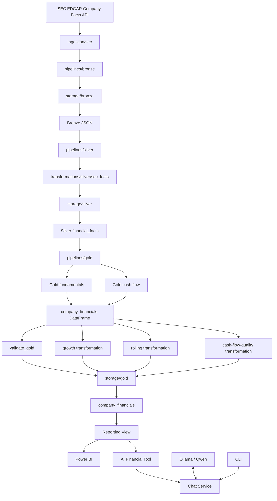

# AlphaLake Architecture

This document describes the current AlphaLake architecture after the pipeline refactor that separated ingestion, transformation, storage, orchestration, runtime, quality, and AI responsibilities.

The central design principle is:

> Keep business transformations independent from where data is stored.

The same pipeline functions can therefore run locally or on Databricks by selecting a storage destination.

---

## 1. Architectural Layers

```text
src/
├── ingestion/        # external source access
├── transformations/  # DataFrame → DataFrame logic
├── storage/          # local / Databricks persistence
├── pipelines/        # stage orchestration
├── runtime/          # Spark creation/configuration
├── quality/          # validation
└── ai/               # LLM + tool orchestration
```

Infrastructure as Code is intentionally separate:

```text
infrastructure/
└── terraform/
```

`src/runtime/` is application runtime configuration.  
`infrastructure/terraform/` is deployment infrastructure.

---

## 2. High-Level Architecture



---

## 3. Shared Pipeline / Backend-Specific Storage

AlphaLake does not maintain separate transformation pipelines for local and Databricks execution.

Instead:

```text
shared pipeline
      ↓
shared transformation
      ↓
storage abstraction
   ↙             ↘
local         databricks
```

Examples:

```python
run_bronze(..., destination="local")
run_bronze(..., destination="databricks")

run_silver(..., destination="local")
run_silver(..., destination="databricks")

run_gold(..., destination="local")
run_gold(..., destination="databricks")
```

The branch between local and Databricks belongs in `src/storage`, not in transformation code.

---

## 4. Storage Configuration

Environment-specific locations are centralized in:

```text
src/storage/path.py
```

Current configuration:

```python
STORAGE_PATH = {
    "local": {
        "bronze": "data/bronze/sec",
        "silver": "data/silver/sec",
        "gold": "data/gold/sec",
    },
    "databricks": {
        "bronze": "/Volumes/alphalake/raw/data/bronze/sec",
        "silver": "alphalake.silver.financial_facts",
        "gold": "alphalake.gold",
    },
}
```

This keeps path/table decisions out of transformations and pipelines.

---

## 5. SEC Identity Configuration

The SEC requests a descriptive `User-Agent`, so AlphaLake passes a name and email into SEC ingestion.

### Local

Local execution reads:

```text
SEC_NAME
SEC_EMAIL
```

from environment variables, normally loaded from a `.env` file.

```env
SEC_NAME=Your Name
SEC_EMAIL=your-email@example.com
```

The `.env` file should not be committed.

### Databricks

The Databricks notebook should not hardcode identity values.

Recommended flow:

```text
Terraform / Databricks Job parameter
↓
Databricks notebook widget
↓
run_bronze(name, email, destination="databricks")
```

Example:

```python
dbutils.widgets.text("sec_name", "")
dbutils.widgets.text("sec_email", "")

sec_name = dbutils.widgets.get("sec_name")
sec_email = dbutils.widgets.get("sec_email")

run_bronze(
    tickers=tickers,
    name=sec_name,
    email=sec_email,
    destination="databricks",
)
```

A Databricks secret can also be used if preferred, but the pipeline interface remains the same.

---

## 6. Bronze Architecture

Bronze preserves the SEC Company Facts response with minimal modification.

### Local

```text
data/bronze/sec/<TICKER>/companyfacts.json
```

### Databricks

```text
/Volumes/alphalake/raw/data/bronze/sec/<TICKER>/companyfacts.json
```

Because both destinations expose file paths, Bronze uses one shared writer:

```python
save_company_facts(
    ticker,
    data,
    destination,
)
```

The only difference is the configured root path.

Bronze reads use:

```python
spark.read.text(path, wholetext=True)
```

so Silver receives one raw JSON document in a `value` column.

---

## 7. Silver Architecture

Silver converts the nested SEC Company Facts document into normalized filing-level facts.

Pipeline:

```text
read_bronze()
↓
transform_sec_facts()
↓
write_financial_facts()
```

The transformation is ticker-aware and normalizes SEC facts into a consistent schema.

Typical fields:

```text
ticker
concept
unit
accession_number
period_start_date
period_end_date
filing_date
filing_form
fiscal_period
reporting_frame
fiscal_year
value
```

### Local storage

```text
data/silver/sec/financial_facts/
```

Format:

```text
Parquet
partitionBy("ticker")
dynamic partition overwrite
```

### Databricks storage

```text
alphalake.silver.financial_facts
```

Format:

```text
Delta
partitioned by ticker
replaceWhere on the processed ticker
```

### Silver reads

`read_silver()` supports both use cases:

```python
read_silver(
    spark,
    destination,
)
```

returns the complete Silver dataset.

```python
read_silver(
    spark,
    destination,
    ticker="AAPL",
)
```

returns one company.

This keeps local and Databricks read behavior behind the same storage interface.

---

## 8. Gold Architecture

Gold is divided into:

1. a core analytical dataset
2. derived analytical datasets

### 8.1 Core Gold

Two transformations consume Silver directly:

```text
annual_derived_metrics(silver_df)
annual_cash_flow_metrics(silver_df)
```

They produce:

```text
fundamental_df
cash_flow_df
```

The Gold pipeline joins them by:

```text
ticker + period_date
```

to create:

```text
company_financials
```

Conceptually:

```text
             ┌─ annual_derived_metrics ──┐
Silver ──────┤                           ├─ join ─→ company_financials
             └─ annual_cash_flow_metrics ┘
```

Typical core metrics:

```text
revenue
net_income
operating_income
assets
equity
operating_margin
net_profit_margin
return_on_assets
return_on_equity
operating_cash_flow
capex
free_cash_flow
```

Source provenance is retained for selected fallback metrics, such as:

```text
operating_cash_flow_source
capex_source
```

---

## 9. Derived Gold Datasets

The core Gold DataFrame is the input to higher-level analytical transformations.

```text
company_financials
├── annual_growth_metrics()
├── rolling_metrics()
└── cash_flow_quality()
```

Outputs:

```text
growth_metrics
rolling_metrics
cash_flow_quality
```

This creates a clear dependency:

```text
Silver
↓
Core Gold
↓
Derived Gold
```

The derived transformations do not need to reinterpret SEC concepts.

---

## 10. Gold Quality Boundary

The core Gold dataset is validated before storage:

```text
transform
↓
join
↓
validate_gold()
↓
write
```

Current checks:

```text
not empty
ticker not null
period_date not null
ticker + period_date unique
```

This establishes `company_financials` as the validated analytical foundation for the derived Gold datasets.

---

## 11. Gold Storage Strategy

### Local

All Gold datasets are written as partitioned Parquet:

```text
data/gold/sec/company_financials/
data/gold/sec/growth_metrics/
data/gold/sec/rolling_metrics/
data/gold/sec/cash_flow_quality/
```

Partition:

```text
ticker
```

### Databricks

Tables:

```text
alphalake.gold.company_financials
alphalake.gold.growth_metrics
alphalake.gold.rolling_metrics
alphalake.gold.cash_flow_quality
```

#### `company_financials`

The main historical table uses change-aware merge behavior.

```text
incoming company_financials
↓
compare with target on ticker + period_date
↓
new / changed rows only
↓
Delta MERGE
```

Identical rows are skipped.

#### Derived Gold tables

The three derived tables are deterministic outputs of the complete Gold dataset.

Current behavior:

```text
recompute full dataset
↓
overwrite table
```

This intentionally avoids maintaining separate incremental logic for every derived metric table.

Important contract:

> A full Gold run should receive the complete Silver dataset.

Calling the full Gold pipeline with only one ticker would overwrite the derived Databricks tables with only that ticker.

If single-ticker Gold refreshes become a requirement later, the derived-table write strategy should be changed to ticker-scoped updates.

---

## 12. Local Orchestration

The local entrypoint is:

```text
src/pipelines/local.py
```

Flow:

```text
get_spark_session()
↓
read SEC_NAME / SEC_EMAIL
↓
run_bronze(...)
↓
run_silver(...)
↓
read_silver(all)
↓
run_gold(...)
```

The local path selects:

```python
destination = "local"
```

and therefore uses local JSON/Parquet storage through the same shared storage interfaces.

The refactored local pipeline has been executed successfully end to end.

---

## 13. Databricks Orchestration

There is no need for a second `src/pipelines/databricks.py` containing duplicate logic.

Databricks should use thin notebook/job entrypoints that call the shared pipeline.

Recommended structure:

```text
notebooks/
├── bronze.py
├── silver.py
└── gold.py
```

### Bronze task

```python
from src.pipelines.bronze import run_bronze

run_bronze(
    tickers=tickers,
    name=sec_name,
    email=sec_email,
    destination="databricks",
)
```

### Silver task

```python
from src.pipelines.silver import run_silver

run_silver(
    spark=spark,
    tickers=tickers,
    destination="databricks",
)
```

### Gold task

```python
from src.storage.silver import read_silver
from src.pipelines.gold import run_gold

silver_df = read_silver(
    spark=spark,
    destination="databricks",
)

run_gold(
    silver_df,
    destination="databricks",
)
```

The notebooks contain only runtime/job wiring.

---

## 14. Databricks Lakehouse Layout

```text
Unity Catalog: alphalake
│
├── raw
│   └── Volume: data
│       └── bronze/
│           └── sec/
│               └── <TICKER>/
│                   └── companyfacts.json
│
├── silver
│   └── financial_facts
│
└── gold
    ├── company_financials
    ├── growth_metrics
    ├── rolling_metrics
    └── cash_flow_quality
```

---

## 15. Reporting Architecture

The stable reporting interface remains:

```text
alphalake.gold.v_company_financials_report
```

Flow:

```text
company_financials
↓
reporting view
↓
Power BI
```

The view isolates reporting consumers from internal storage/transformation changes.

---

## 16. AI Assistant Architecture

Current AI flow:

```text
User
↓
cli.py
↓
process_message()
↓
Qwen via Ollama
↓
tool needed?
├── no  → direct response
└── yes → execute all requested tool calls
          ↓
       append tool results
          ↓
       final LLM response
```

Package:

```text
src/ai/
├── client.py
├── prompts.py
├── chat_service.py
├── cli.py
└── tools/
    ├── financials.py
    ├── registry.py
    └── executor.py
```

Responsibilities:

```text
client.py
→ Ollama/OpenAI-compatible client

prompts.py
→ system grounding instructions

chat_service.py
→ one-turn LLM/tool orchestration

cli.py
→ terminal interface

registry.py
→ tool schemas

executor.py
→ tool dispatch

financials.py
→ Databricks SQL financial retrieval
```

The current service uses:

```text
tool_choice="auto"
```

so non-financial questions are not forced through the database.

Financial data should come from deterministic AlphaLake tools, while the LLM is responsible for synthesis and explanation.

---

## 17. LLM Boundary

```text
Exact financial data
→ Databricks / SQL / Python

Natural-language interpretation
→ LLM
```

This keeps numerical logic testable and reduces the risk of hallucinated financial values.

---

## 18. Infrastructure and CI/CD

Terraform remains outside `src`:

```text
infrastructure/
└── terraform/
```

Responsibilities include:

```text
Databricks Job
task dependencies
Git integration
runtime/serverless configuration
job parameters
schedule
```

CI/CD:

```text
Git push / pull request
↓
GitHub Actions
↓
terraform fmt
terraform init
terraform validate
terraform plan
↓
main branch
↓
terraform apply
↓
Databricks
```

State:

```text
HCP Terraform
```

This allows local Terraform and GitHub Actions to share one remote state backend.

---

## 19. Scheduling

The production Databricks job is scheduled through Terraform.

Typical stage order:

```text
Bronze
↓
Silver
↓
Gold
```

The Gold pipeline performs core Gold validation internally before publication.

---

## 20. Iceberg Boundary

Apache Iceberg is retained as a local experimentation/synchronization utility.

It is not the primary backend of the current shared Bronze/Silver/Gold pipeline.

Use cases:

```text
MERGE experiments
snapshot history
table-format learning
```

Primary storage model:

```text
Local       → JSON + Parquet
Databricks  → Volume JSON + Delta
```

---

## 21. Current Application Boundary

Implemented:

```text
SEC structured ingestion
shared Bronze/Silver/Gold pipeline
local storage backend
Databricks storage backend
core + derived Gold datasets
Gold quality checks
Databricks reporting view
Power BI
Terraform
GitHub Actions
local grounded AI assistant
Databricks-backed financial tool
```

Next application boundary:

```text
FastAPI
├── POST /chat
├── GET /companies/{ticker}
└── GET /health
```

FastAPI should call the existing service and storage/tool interfaces rather than recreating AI or financial retrieval logic.

---

## 22. Future Research Path

Planned direction:

```text
user asks for a company
↓
company exists in AlphaLake?
├── yes → use stored structured data
└── no  → SEC onboarding pipeline
          ↓
       Bronze → Silver → Gold
          ↓
       answer from AlphaLake
```

Later, an unstructured path can be added:

```text
SEC filings
↓
text extraction
↓
chunking
↓
embeddings
↓
retrieval
↓
LLM
```

Long-term target:

```text
Structured evidence + filing evidence
↓
deterministic tools + retrieval
↓
LLM synthesis
↓
evidence-grounded research answer
```

AlphaLake is intended as an AI-assisted fundamental research platform, not a stock-price prediction or automated investment-advice system.
