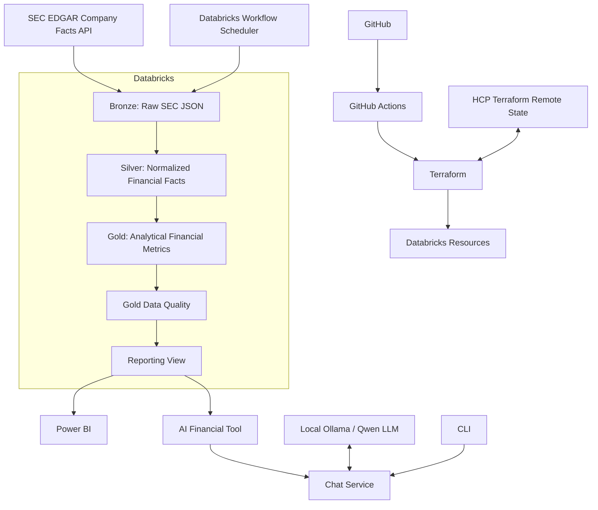

# AlphaLake Architecture

AlphaLake is a financial data lakehouse and AI-assisted research platform. The current implementation combines an automated SEC-to-Databricks data pipeline with Power BI reporting and a local LLM assistant that retrieves structured financial data from Databricks before answering financial questions.

## 1. High-Level Architecture



The platform has three main paths:

```text
Data path
SEC → Bronze → Silver → Gold → Quality → Reporting View

Analytics path
Reporting View → Power BI

AI path
User → CLI → Chat Service → LLM → Tool Call → Databricks → LLM → Answer
```

## 2. Data Architecture

### Bronze

Bronze preserves the original SEC Company Facts response with minimal transformation.

Databricks location:

```text
/Volumes/alphalake/raw/data/bronze/sec/<TICKER>/companyfacts.json
```

Purpose:

```text
Preserve source data
Enable reproducibility
Allow reprocessing
```

### Silver

Silver normalizes the deeply nested SEC Company Facts structure into filing-level financial facts.

Production table:

```text
alphalake.silver.financial_facts
```

Core principle:

> How did the SEC report the financial information?

Silver preserves filing history and source accounting concepts rather than immediately collapsing records into one annual metric.

### Gold

Gold maps SEC accounting concepts into company-level analytical metrics.

Production table:

```text
alphalake.gold.company_financials
```

Examples:

```text
revenue
net_income
operating_income
assets
equity
operating_margin
net_profit_margin
return_on_assets
return_on_equity
operating_cash_flow
capex
free_cash_flow
```

Core principle:

> What does the financial information mean analytically?

The business key is:

```text
ticker + period_date
```

Incoming Gold rows are compared with existing data so only new or changed rows are merged.

## 3. Data Quality

Gold data is validated before downstream consumption.

Current checks include:

```text
Dataset is not empty
Ticker is not null
Period date is not null
Ticker + period_date is unique
```

A failed validation raises an exception and fails the Databricks workflow.

## 4. Reporting Architecture

Power BI consumes a stable reporting view rather than depending directly on the internal Gold table.

```text
alphalake.gold.company_financials
                ↓
alphalake.gold.v_company_financials_report
                ↓
             Power BI
```

This creates a stable consumer contract and allows the internal Gold implementation to evolve independently.

## 5. AI Assistant Architecture

The current AI assistant is intentionally grounded in AlphaLake data. For financial questions, the LLM is instructed to use an available financial tool instead of answering from pretrained knowledge.

Current flow:

```text
User question
     ↓
cli.py
     ↓
chat_service.py
     ↓
SYSTEM_PROMPT + conversation history
     ↓
Local Qwen model through Ollama
     ↓
LLM requests get_financial_report
     ↓
tools/registry.py describes the tool
     ↓
tools/executor.py dispatches the tool call
     ↓
tools/financials.py queries Databricks SQL
     ↓
Pandas DataFrame → JSON
     ↓
Tool result returned to LLM
     ↓
Grounded natural-language answer
```

Current AI package:

```text
src/ai/
├── client.py
├── prompts.py
├── chat_service.py
├── cli.py
└── tools/
    ├── __init__.py
    ├── financials.py
    ├── registry.py
    └── executor.py
```

Responsibilities:

```text
client.py
→ creates the OpenAI-compatible client for Ollama

prompts.py
→ contains AlphaLake's system instructions

chat_service.py
→ orchestrates one conversation turn and tool-calling flow

cli.py
→ terminal input/output only

tools/financials.py
→ implements the financial data retrieval function

tools/registry.py
→ exposes tool schemas to the LLM

tools/executor.py
→ maps an LLM tool name to the corresponding Python function
```

The separation allows the same chat service to be reused by another interface later without embedding terminal-specific code into the AI logic.

## 6. LLM Boundary

The LLM should explain and synthesize financial information, but deterministic financial values should come from AlphaLake data and Python/SQL logic.

```text
Exact financial values / calculations
→ Databricks + Python/SQL

Natural-language interpretation
→ LLM
```

This reduces hallucination risk and keeps numerical logic testable.

## 7. Orchestration

The production pipeline runs as a multi-task Databricks Job:

```text
01_bronze_ingestion
        ↓
02_silver_transform
        ↓
03_gold_transform
        ↓
04_gold_quality
```

The workflow is scheduled daily through Terraform.

## 8. Infrastructure and CI/CD

Infrastructure is defined with Terraform and deployment is automated with GitHub Actions.

```text
Git push / pull request
        ↓
GitHub Actions
        ↓
terraform fmt
terraform init
terraform validate
terraform plan
        ↓
main branch
        ↓
terraform apply
        ↓
Databricks
```

Terraform state is stored remotely in HCP Terraform so local development and CI/CD use the same state backend.

Repository-level infrastructure layout:

```text
terraform/
├── providers.tf
├── variables.tf
├── databricks_job.tf
├── outputs.tf
└── versions.tf
```

## 9. Local and Production Storage

AlphaLake was developed locally with Parquet and Apache Iceberg for experimentation with table formats, snapshots, and MERGE behavior.

Production uses Databricks, Delta Lake, and Unity Catalog.

The architectural goal is to keep transformation logic separate from storage concerns:

```text
Transformation logic
        ↓
Storage boundary
   ↙          ↘
Local       Databricks
```

## 10. Current vs Planned Application Architecture

Implemented now:

```text
SEC ingestion
Bronze / Silver / Gold
Data quality
Databricks workflow
Terraform + HCP state
GitHub Actions
Reporting view
Power BI
CLI-based grounded AI assistant
Databricks financial tool calling
```

Next planned application layer:

```text
FastAPI
├── POST /chat
├── GET /companies/{ticker}
└── GET /health
```

The goal is for FastAPI to reuse `chat_service.py` rather than duplicate AI logic.

After the API layer, planned extensions include:

```text
Automatic SEC company onboarding
SEC filing ingestion for unstructured text
Embeddings and semantic retrieval
RAG over annual reports / filings
Additional deterministic financial tools
Company comparison and research workflows
```

## 11. Target Research Architecture

```text
                       AlphaLake

                 Structured financial path
SEC Company Facts → Bronze → Silver → Gold → Financial Tools
                                           │
                                           ├────────────┐
                                           │            │
                                           ▼            ▼
                                      Power BI      Chat Service
                                                        ▲
                                                        │
                 Unstructured research path             │
SEC Filings → Text extraction → Chunks → Embeddings → Retrieval
                                                        │
                                                        ▼
                                                       LLM
                                                        │
                                                        ▼
                                           Evidence-grounded explanation
```

The long-term goal is an AI-assisted fundamental research platform, not a stock-price prediction system. AlphaLake should organize evidence, calculate reliable metrics, retrieve relevant filing context, and explain what matters while leaving investment decisions to the user.
